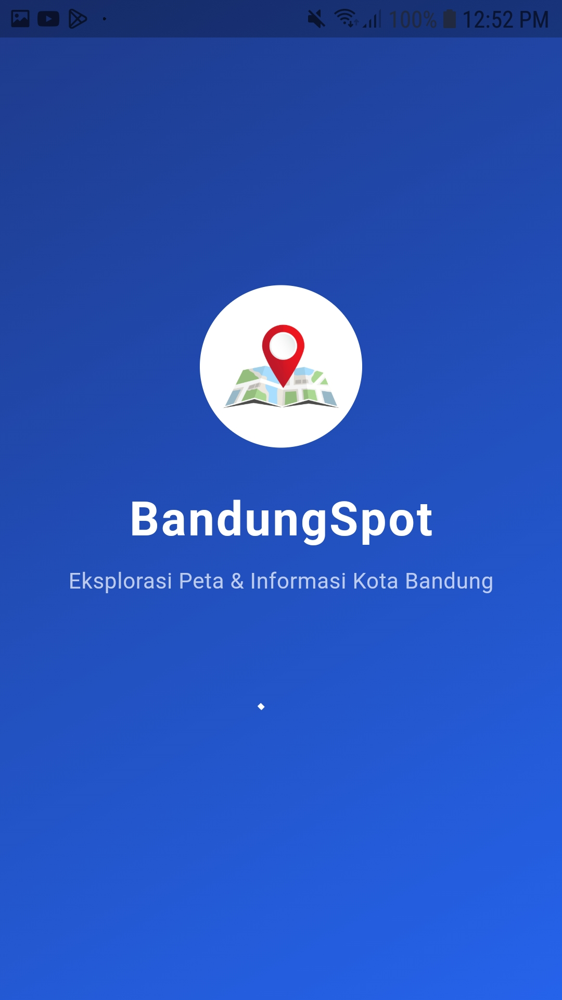
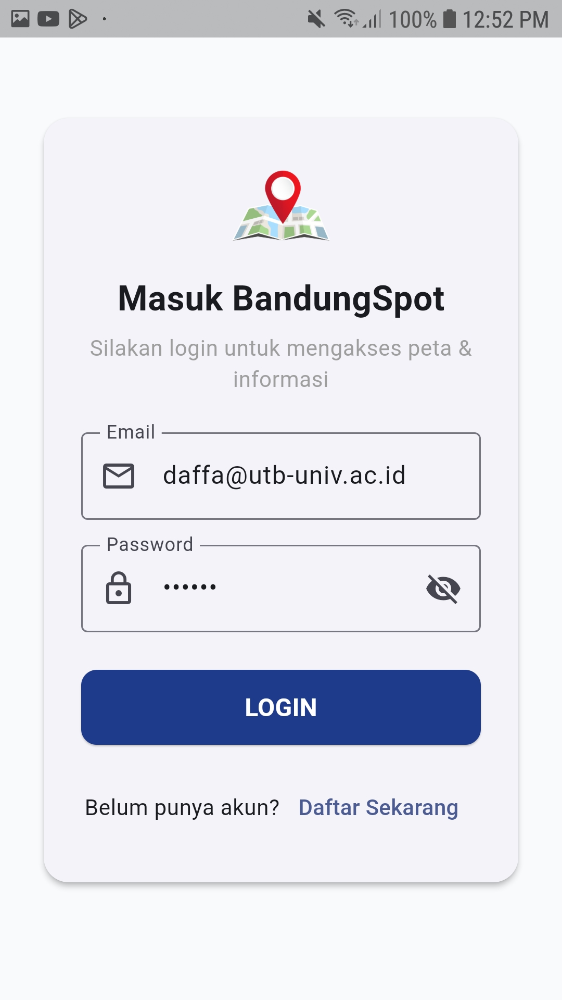
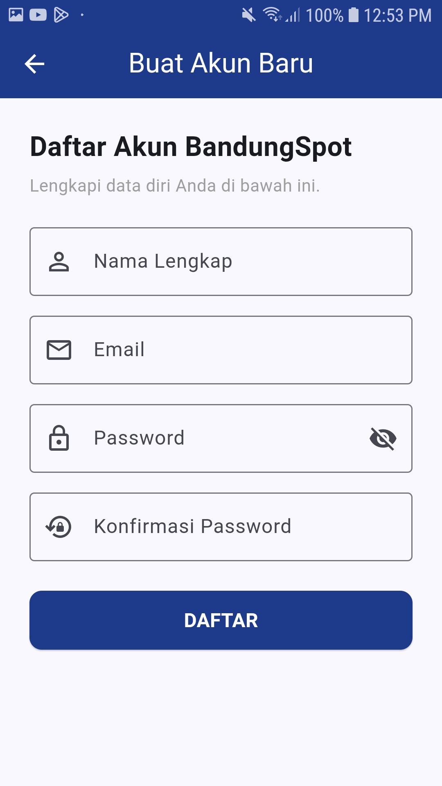
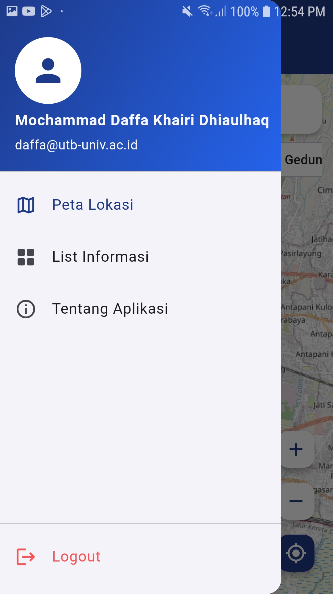
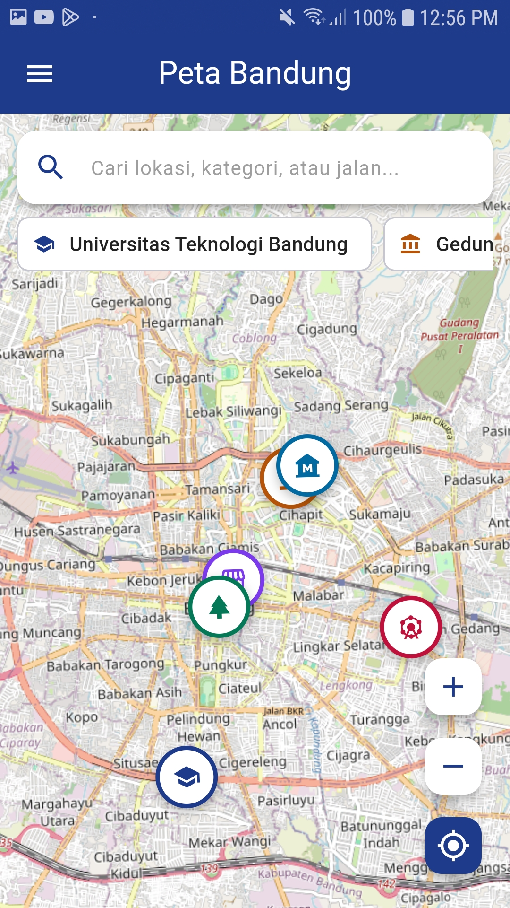
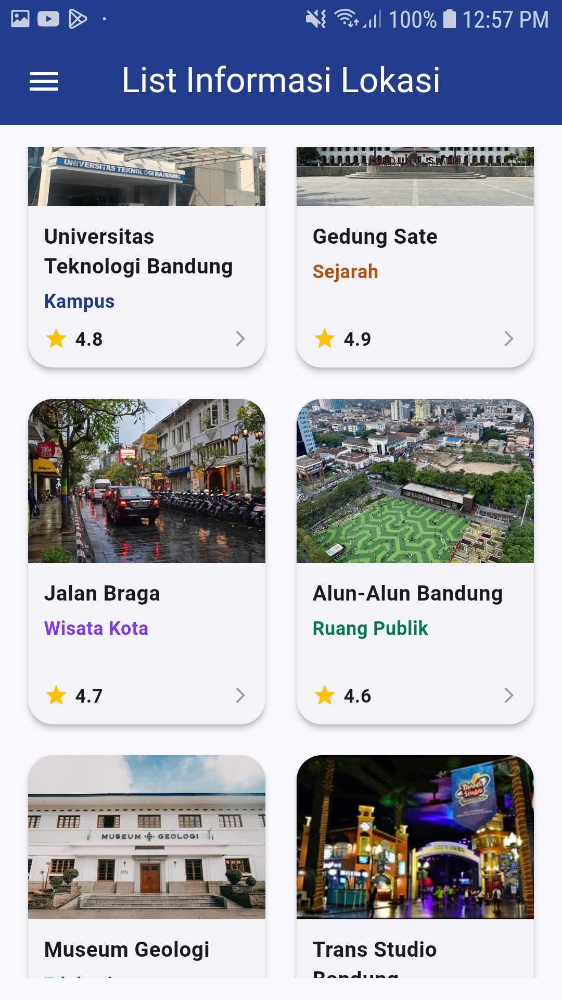
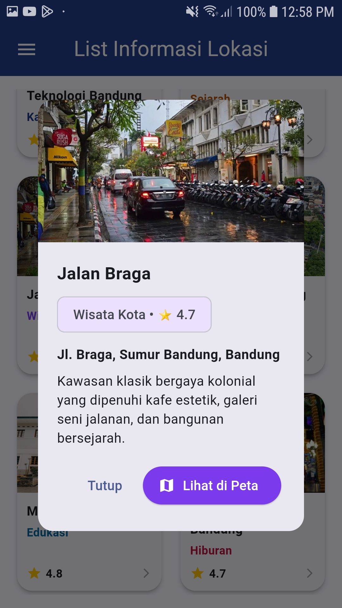
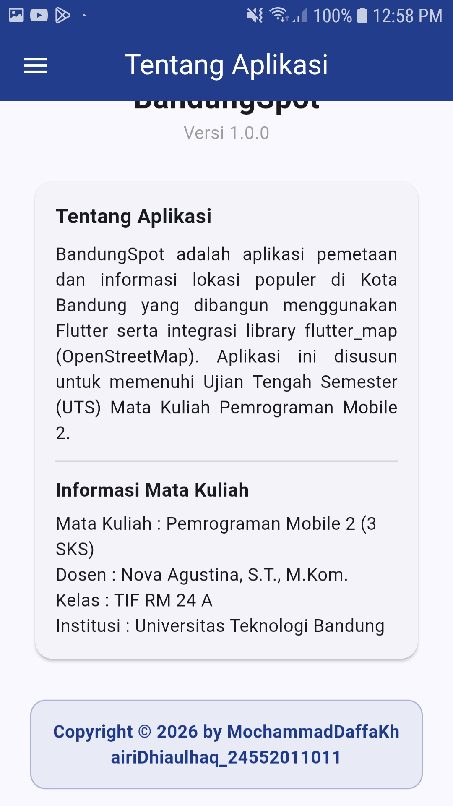

<p align="center">
  
</p>

<h1 align="center">BandungSpot</h1>

<p align="center">
  <b>Aplikasi Pemetaan Interaktif & Informasi Lokasi Populer Kota Bandung</b><br/>
  Dibangun menggunakan Flutter & OpenStreetMap (<code>flutter_map</code>) untuk memenuhi Ujian Tengah Semester (UTS) Mata Kuliah Pemrograman Mobile 2.
</p>

<p align="center">
  
  
  
</p>

---

## Tentang Aplikasi

**BandungSpot** adalah aplikasi mobile berbasis Flutter yang dirancang untuk membantu pengguna mengeksplorasi berbagai lokasi ikonik di Kota Bandung—mulai dari kampus, bangunan bersejarah, kawasan wisata kota, ruang publik, museum edukasi, hingga taman hiburan.

Aplikasi ini mengintegrasikan library **`flutter_map`** berbasis **OpenStreetMap** secara interaktif dengan fitur pencarian real-time, pin lokasi kustom, kontrol zoom, serta sinkronisasi langsung antara halaman **List Informasi (GridView)** dengan titik koordinat pada peta.

---

## Informasi Akademik

| Keterangan | Detail |
| :--- | :--- |
| **Nama** | Mochammad Daffa Khairi Dhiaulhaq |
| **NPM** | 24552011011 |
| **Kelas** | TIF RM 24 A |
| **Mata Kuliah** | Pemrograman Mobile 2 (3 SKS) |
| **Dosen Pengampu** | Nova Agustina, S.T., M.Kom. |
| **Institusi** | Universitas Teknologi Bandung (UTB) |

---

## Fitur Utama

* **Splash Screen**: Halaman pembuka dengan logo aplikasi **BandungSpot** dan transisi otomatis menuju halaman Login.
* **Autentikasi (Login & Register)**: Validasi form email/password serta simulasi pendaftaran akun baru yang langsung dapat digunakan untuk masuk ke aplikasi.
* **Sidebar Navigation (`Drawer`)**: Menu navigasi samping yang menampilkan profil pengguna aktif, perpindahan antar halaman utama, serta fitur Logout dengan dialog konfirmasi.
* **Peta Interaktif (`flutter_map` & `latlong2`)**:
  * Menampilkan *tile* peta OpenStreetMap Kota Bandung dengan *custom marker* untuk setiap lokasi.
  * **Search Bar Real-Time**: Pencarian lokasi berdasarkan nama tempat, kategori, atau nama jalan lengkap dengan daftar saran otomatis (*autocomplete*).
  * **Pintasan Lokasi & Kontrol Peta**: Chip navigasi cepat, tombol *Zoom In*, *Zoom Out*, *Reset Center*, serta *Bottom Sheet* detail lokasi saat marker ditekan.
* **List Informasi (`GridView.builder`)**: Menampilkan daftar lokasi populer dalam format grid 2 kolom lengkap dengan foto lokal masing-masing tempat, rating, dialog detail, serta tombol **"Lihat di Peta"** yang langsung mengarahkan kamera peta ke lokasi tersebut.
* **Tentang Aplikasi**: Menampilkan informasi aplikasi, data mata kuliah, dan hak cipta pengembang.

---

## Tangkapan Layar (Screenshots)

| Splash Screen | Halaman Login | Halaman Register | Sidebar Navigation |
| :---: | :---: | :---: | :---: |
|  |  |  |  |

| Peta (Flutter Maps) | List Informasi (GridView) | Detail Informasi Lokasi | About Aplikasi |
| :---: | :---: | :---: | :---: |
|  |  |  |  |

---

## Struktur Project

```text
bandung_spot/
├── assets/
│   ├── images/                # Logo pin_maps.png & foto lokasi lokal
│   └── screenshots/           # Tangkapan layar aplikasi untuk dokumentasi
├── lib/
│   ├── main.dart              # Entry point aplikasi & tema Material 3
│   ├── models/
│   │   └── app_data.dart      # Model UserAccount, AuthStorage, & data SpotLocation
│   └── screens/
│       ├── splash_screen.dart
│       ├── login_screen.dart
│       ├── register_screen.dart
│       ├── main_screen.dart   # Navigasi Drawer (Sidebar)
│       ├── map_screen.dart    # Integrasi flutter_map + Search Bar
│       ├── info_grid_screen.dart
│       └── about_screen.dart
└── pubspec.yaml